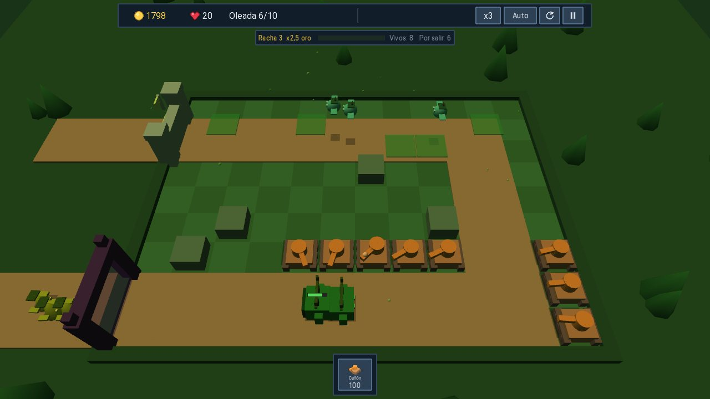
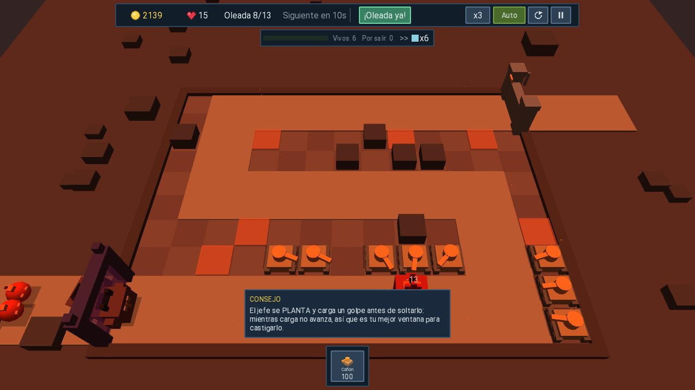
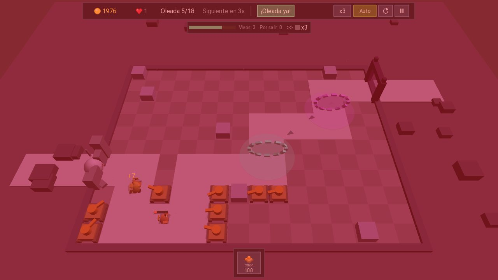

# Tank Defense

Defensa de torres en 3D hecha con libGDX (Java) para **Windows** y **Android**.
Las torres son tanques que se despliegan desde un helicóptero en paracaídas, se
reubican conduciendo por el tablero y se fusionan entre sí.

Todo se genera por código: no hay un solo archivo de imagen, modelo ni sonido
entre los assets del juego. El arte 3D se construye con primitivas
(`ModelBuilder`), la música y los efectos se sintetizan en tiempo de ejecución,
y los únicos datos externos son JSON. La tipografía Roboto es la excepción.

## Capturas

| Bosque | Desierto, con el jefe | Cristal, con portales |
|---|---|---|
|  |  |  |

## Características

- **50 niveles** en **10 biomas** (5 niveles cada uno). Cada bioma tiene paleta
  propia, skin de enemigos, una **mecánica de mapa** (tormentas de arena,
  arbustos, hielo, lava, niebla, cristales, portales, viento, combos) y una
  **unidad insignia** que solo aparece en él y en el bioma final.
- **13 tanques base** con cinco formas de disparar: proyectil, hitscan
  (francotirador), área continua (lanzallamas), rayo con daño creciente (láser)
  y soporte sin ataque (radar, mando).
- **21 recetas de fusión**: construye un tanque sobre otro con la receta
  desbloqueada y se combinan (p. ej. veneno + ralentizador = Plaga,
  trituradora + cañón = Demoledor). 34 tanques distintos en total.
- **20 enemigos**: tropa con oficio (sanador, zapador, portador que suelta
  carga), voladores, divisores, campeones con aura y un jefe final con guion
  propio.
- **Progresión meta**: árbol de mejoras permanente de **101 nodos** comprado con
  cristales, y edificios de base con doctrinas excluyentes comprados con
  medallas (1 por cada estrella nueva).
- **Modo sin fin** con cartas de refuerzo cada 10 oleadas, hitos de pago y
  récords propios.
- **Tutorial** guiado en los niveles 1-5. Guardado local con escritura atómica.

## Compilar y ejecutar

```bash
# Windows (desktop)
gradlew :lwjgl3:run

# Android (dispositivo por USB o emulador arrancado)
gradlew :android:installDebug

# APK release (sin firmar)
gradlew :android:assembleRelease
```

Flags de desarrollo (solo desktop): `-Dtd.level=42` arranca directo en un
nivel; `-Dtd.autotowers=true` coloca tanques automáticamente. Cualquier flag
`-Dtd.*` cambia el guardado a un perfil de depuración aparte, así que las
pruebas nunca tocan la partida real.

## Herramientas (módulo `tools`)

```bash
# Regenera los niveles 6-50 (los 1-5, tutoriales, son a mano y no se tocan)
gradlew :tools:generateLevels           # no sobrescribe existentes
gradlew :tools:generateLevels -Pforce   # regenera todo

# Simula la campaña sin gráficos con una IA sencilla (validación de balance)
gradlew :tools:simulate                 # campaña base
gradlew :tools:simulate -Pmeta=full     # con el árbol de mejoras completo
gradlew :tools:simulate -Pendless=1     # modo sin fin

# Auditoría de daño: dps por armadura, dps por celda y daño por pasada
gradlew :tools:audit

# Test del ciclo de serialización del guardado
gradlew :tools:checkSave

# Paridad de claves entre idiomas
node tools/i18n-check.js
```

## Estructura

```
assets/            datos JSON (towers, enemies, fusions, biomes, upgrades,
                   buildings), textos (i18n/) y niveles (levels/level_XXX.json)
core/              todo el juego (mundo, render, UI, meta), sin código de plataforma
lwjgl3/            launcher de Windows
android/           launcher de Android (minSdk 21, target 35)
tools/             generador de niveles, simulador, auditoría de balance
```

Puntos clave del código:

- `core/.../world/GameWorld.java` — simulación completa (timestep fijo, sin render)
- `core/.../world/BiomeMechanics.java` — las 10 mecánicas de mapa
- `core/.../render/ModelFactory.java` — todo el "arte" 3D por primitivas
- `core/.../data/Balance.java` + `tools/.../DifficultyCurve.java` — todo el
  balance en fórmulas; cambiar y regenerar niveles
- `core/.../meta/MetaEffects.java` — único punto de aplicación de bonus meta

## Audio

Todo el audio se **sintetiza por código** (`core/src/.../audio/`): efectos y
temas musicales generativos (uno por bioma + menú), cada uno con su escala,
tempo e instrumentación. Los WAV se generan la primera vez que suenan y se
cachean en el almacenamiento local (`audio_v1/`); el APK no lleva ni un byte de
audio. Para regenerarlos tras cambiar el sinte, sube `CACHE_VERSION` en
`SoundManager`.

## Pendiente / ideas

- Traducciones más allá de español e inglés (la infraestructura ya está lista).
- Perfilado en dispositivo Android real (GLProfiler) y firma del APK release.
